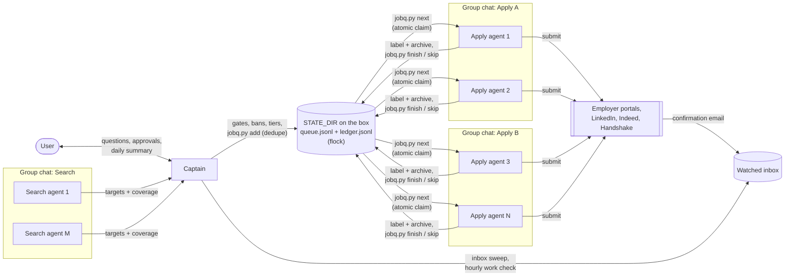

# Run a multi-agent job-application team with Grok Bot

This guide sets up a Grok Bot team that searches for jobs and applies to them for one person:
one manager agent (the **captain**), several **apply** agents, several **search** agents, and the
group chats that connect them. It is the generalized version of the setup the ApplyQueue
maintainers run, with every lesson learned folded in.

A Grok Bot can be pointed at this file and carry out every step on its own. Wherever a step needs
something only the user knows, it says **ASK** and points at the
[questionnaire](templates/questionnaire.md). Everything in this repo is a placeholder
(`Alex Example`, `example.com`). Nothing real belongs in this public repo.

**Everything runs on the Grok Bot box.** There is no GitHub repo, no remote and no multi-device
sync. The box is one persistent Linux machine that every agent of the user can see, so all
state lives in one local folder, `{{STATE_DIR}}` (default `/workspace/JobAutomation`), and
concurrency is handled with file locks.

> Prefer a desktop app instead of agents? **ApplyQueue** (this repo,
> <https://github.com/JonathanLiu1401/ApplyQueue>) is the single-user, cross-platform desktop
> alternative: profile and answers live in a local UI, AI runs through Grok, an API key, your own
> subscription CLI or a local model, and it applies from your own machine. See the
> [README](../README.md#download).

## Contents

1. [How the team works](#1-how-the-team-works)
2. [Ground rules for the bot reading this](#2-ground-rules-for-the-bot-reading-this)
3. [Bootstrap, step by step](#3-bootstrap-step-by-step)
4. [Procedure rules every agent follows](#4-procedure-rules-every-agent-follows)
5. [Knockout gates and targeting](#5-knockout-gates-and-targeting)
6. [Concurrency: locks, claims and the ledger](#6-concurrency-locks-claims-and-the-ledger)
7. [Pause, resume and day-to-day operation](#7-pause-resume-and-day-to-day-operation)
8. [Templates](#8-templates)
9. [Troubleshooting](#9-troubleshooting)

---

## 1. How the team works

| Role | How many | What it does | What it never does |
|---|---|---|---|
| **Captain** (manager agent) | 1 | Owns `{{STATE_DIR}}`, the queue and the ledger. The only agent that talks to the user. Turns search results into queued targets (dedupe, bans, tiers, knockout gates), keeps every apply agent busy, verifies confirmations, runs the routines, relays questions to the user and writes answers back into the profile. | Sends any outside message without the user's OK; changes a fact without the user. |
| **Apply agent** (worker) | N (start with 2 to 4) | Claims one job at a time (`jobq.py next`), fills and submits the application from the profile, confirms by email, labels and archives the mail, records `finish` / `skip` / `fail`. | Searches for other jobs, edits the profile, invents answers, replies to recruiters. |
| **Search agent** (worker) | M (start with 1 or 2) | Searches job boards and company career pages exhaustively for postings that match the user's targets and posts structured targets to the captain with coverage counts. | Applies, or posts banned employers, excluded roles or knocked-out postings as clean. |

### Group chats

Group chats are Grok Bot rooms that hold several agents, so the captain hands off work in one
place instead of N private threads.

| Group chat | Members | Purpose |
|---|---|---|
| **Apply A** | Captain + apply agents 1..k | Kickoffs, questions (`ask`), results, PAUSE / RESUME. |
| **Apply B** | Captain + apply agents k+1..N | Same as Apply A. Add Apply C at about 4+ agents per room. |
| **Search** | Captain + all search agents | Lane assignments, target batches, coverage reports. |

The user's private chat with the captain is where approvals and questions go. Workers never
message the user; they ask the captain in their group chat, and the captain asks the user.

### Hand-off flow



1. **Search** agents post targets in the **Search** chat as JSON lines (company, title, URL,
   location, role family, requisition id, posted date, and any knockout notes they saw). Each
   target is marked CLEAN (no blocker found) or CONDITIONAL (a possible knockout the captain must
   rule on).
2. The **captain** applies the knockout gates and bans (section 5), assigns a tier and role
   family, and pipes survivors into `jobq.py add`, which dedupes against everything already
   queued or applied.
3. **Apply** agents run `jobq.py next --agent "<their name>"`. The claim is atomic under a file
   lock, so no two workers can take the same job. The card names the job and the exact resume.
4. The apply agent applies, runs `jobq.py check` right before Submit, submits, waits for the
   **confirmation email**, labels and archives it, then runs `jobq.py finish` with the email
   subject (or `skip` / `fail` with a reason).
5. The captain's routines verify confirmations in the inbox, keep agents busy, and summarize.

---

## 2. Ground rules for the bot reading this

- **Ask, do not guess.** Any fact about the user that is not in their questionnaire answers is
  unknown. Ask; never invent.
- **Every personal ruling is a question.** This guide never decides the user's policy (which
  employers to avoid, how to answer sponsorship, what graduation date to give). The
  questionnaire asks; the answers go into `profile.json` and `AGENTS.md`.
- **Secrets never go in chat or anywhere public.** Logins go in the Grok Bot vault (preferred) or
  in `{{STATE_DIR}}/secrets/credentials.txt` on the box (mode 600, never copied, never shown in
  chat). If the user pastes a password into chat, do not repeat it; ask them to store it in the
  vault.
- **No outside message without the user's OK**, in their own words, for that message. Submitting
  an application the user asked for is not a message; replying to anyone is.
- **Irreversible actions need explicit approval**: deleting anything, paying for anything, or
  sharing files off the box.
- **Stop means stop.** If the user says stop or pause, every agent stops (section 7).

---

## 3. Bootstrap, step by step

The captain runs these in order and keeps a checklist in `{{STATE_DIR}}/logs/bootstrap.md`, so a
restart resumes where it left off.

### 3.1 Run the questionnaire

**ASK** every question in [templates/questionnaire.md](templates/questionnaire.md), a few at a
time, in the order given. Record answers directly into `profile.json` (3.4). Anything the user
skips is `"not answered"`: an untouched default is "not answered", never a guess, and agents
treat it as "stop and ask". Do not proceed to 3.5 until every **required** answer is filled.

### 3.2 Connect email

Connect the inbox the user chose to watch, with the Gmail or Outlook connector. Confirm it can
search, read, label (Gmail) or move to a folder (Outlook), and archive. Create the label or folder
`{{CONFIRMATION_LABEL}}` (the maintainers use `J*bs`) if it does not exist. If the connector
cannot label, sign the inbox into the box browser once instead; agents then work in that one tab.
Never open a second Google login in the same browser.

No GitHub connection is needed.

### 3.3 Create the state folder on the box

**ASK** for the folder (default `/workspace/JobAutomation`). Then:

```bash
STATE_DIR=/workspace/JobAutomation        # {{STATE_DIR}}
mkdir -p "$STATE_DIR"/{bin,resumes,documents,logs,secrets,browser}
chmod 700 "$STATE_DIR/secrets"
cd "$STATE_DIR" && git init -q 2>/dev/null || true   # optional local history, NO remote, never push
```

Layout:

```
{{STATE_DIR}}/                       box-local only; never published, never synced off the box
├── AGENTS.md                        procedure every agent reads before acting (templates/AGENTS.template.md)
├── ATS_PLAYBOOK.md                  per-portal quirks (templates/ats-playbook.md)
├── profile.json                     facts for forms (templates/profile.example.md)
├── knowledge.json                   stories and projects for essays (templates/knowledge.example.md)
├── company_tiers.json               tiers, bans, gates (templates/company_tiers.example.md)
├── resumes/                         one PDF per role family, mapped in profile.json documents.resume_map
├── documents/transcript.pdf         only if the user provided one
├── bin/jobq.py                      queue + ledger tool with flock (templates/jobq.md)
├── bin/browser-slot.sh              per-worker browser profile + debug port (templates/browser-slots.md)
├── queue.jsonl                      targets, append-only (written by jobq.py)
├── ledger.jsonl                     events, append-only (written by jobq.py)
├── PAUSED                           exists only while the team is paused
├── questions.jsonl                  open questions for the user
├── secrets/credentials.txt          ONLY if the user chose box storage over the vault (chmod 600)
├── browser/                         per-worker browser profiles (master + worker-N)
└── logs/                            bootstrap checklist, daily summaries, screenshots
```

If the optional local git repo is used: never add a remote, never push, and keep `secrets/`,
`browser/` and `logs/` out of it (`printf 'secrets/\nbrowser/\nlogs/\n.jobq.lock\n' > .gitignore`).
It exists only for a local history of profile edits.

### 3.4 Write the files

1. `profile.json` from [templates/profile.example.md](templates/profile.example.md), filled from
   the questionnaire.
2. `knowledge.json` from [templates/knowledge.example.md](templates/knowledge.example.md), built
   from the resume(s) and section I of the questionnaire. Show the user a summary and **ASK** them
   to correct it. Every claim must trace back to the resume or the user's own words.
3. `company_tiers.json` from [templates/company_tiers.example.md](templates/company_tiers.example.md).
4. `AGENTS.md` from [templates/AGENTS.template.md](templates/AGENTS.template.md): replace every
   `{{PLACEHOLDER}}`; check with `grep -n '{{' AGENTS.md` that none remain.
5. `ATS_PLAYBOOK.md` from [templates/ats-playbook.md](templates/ats-playbook.md), as is.
6. `bin/jobq.py` from [templates/jobq.md](templates/jobq.md) and `bin/browser-slot.sh` from
   [templates/browser-slots.md](templates/browser-slots.md); `chmod +x bin/*`.
7. Copy each resume PDF into `resumes/` and run `bin/jobq.py resume-file <role_family>` for each
   role family to prove the mapping resolves to a real PDF.

### 3.5 Logins and browsers

1. For each job site the user named (LinkedIn, Indeed, Handshake, Glassdoor, existing portal
   accounts), save the login in the Grok Bot vault. Fallback: `secrets/credentials.txt`, one block
   per site or ATS tenant (format in [templates/ats-playbook.md](templates/ats-playbook.md)).
2. Sign each site in once in the box browser. Box browser sessions persist and every agent on the
   box can use them.
3. If workers drive a scripted Chromium (Playwright / CDP) rather than their own Grok Bot browser
   window, give each worker its own profile and debug port with `bin/browser-slot.sh`
   (section 6.3). Never share one profile or port between two agents.

### 3.6 Create the agents

**ASK** how many apply agents (N, default 2) and search agents (M, default 1). More agents use
more of the user's actions; start small.

Create each with `CreateAgent`, using the copy-paste descriptions in
[templates/agent-descriptions.md](templates/agent-descriptions.md), placeholders filled. Name
them so the user can tell them apart, e.g. `Apply 1 · {{USER_FIRST_NAME}} jobs`,
`Search 1 · {{USER_FIRST_NAME}} jobs`. The captain keeps the Captain description.

### 3.7 Create the group chats

- **Apply A**: captain + first half of the apply agents.
- **Apply B**: captain + the rest (skip if N is 1 or 2).
- **Search**: captain + every search agent.

Post the room purpose (section 1) as the first message in each room. Then give each search agent
a lane (role families, company groups, or job boards) and tell each apply agent to start its
`jobq.py next` loop once the queue has jobs.

### 3.8 Set up routines

Create the routines in [templates/routine-prompts.md](templates/routine-prompts.md) with
`UpdateRoutine`. Schedules are cron in the user's local time, weekdays and waking hours unless
the user asks otherwise; pick minutes that are not :00 or :30.

| Routine | Suggested cron | Purpose |
|---|---|---|
| Inbox confirmation sweep | `17 8-20/2 * * 1-5` | Label `{{CONFIRMATION_LABEL}}` + archive confirmations, OTP, verification and password-reset mail; reconcile the ledger. |
| Follow-up inbox watch | `47 9-18 * * 1-5` | Post-submit forms, assessments, interviews, rejections. |
| Hourly work check | `23 9-19 * * 1-5` | Idle or stuck workers, expired claims, low queue, daily cap. |
| Search sweep | `41 7 * * 1-5` (optionally `41 13 * * 1-5`) | Assign lanes, collect targets, gate and queue them. |
| Daily summary | `53 18 * * 1-5` | One message to the user. |

Workers get no routines of their own; the captain wakes them in their group chat.

### 3.9 Dry run, then go

1. Queue one real tier 1 job and have Apply 1 take it end to end while the captain watches.
2. Check: every field answered, right resume, `check` before Submit, confirmation found,
   labeled, archived, `finish` recorded (`bin/jobq.py status`).
3. Show the user the result. **ASK** "Start the full team?"
4. On yes, start the search sweep and kick every apply agent.

---

## 4. Procedure rules every agent follows

Generalized from the maintainers' private procedure file. All of them are in
[templates/AGENTS.template.md](templates/AGENTS.template.md).

### Answering

1. **Answer every question, optional ones included.** Never leave a field blank, never skip an
   optional question, essay, cover-letter box, "why us", "anything else?", skills, projects,
   links or extra-info field. These give the candidate an edge.
2. **Truthful, from the source of truth only:** `profile.json` for facts, `knowledge.json` and
   the uploaded resume for stories. Tailor the wording to the company, never the facts. Essays get
   a full answer (a few hundred words) built on a real story.
3. **EEO / voluntary self-identification:** use the user's answers in `profile.json` (decline is
   fine) but always pick an option. Read the selected label back: "Female" contains "Male", so a
   loose substring match picks the wrong one.
4. **Unknown means stop and ask.** A `"not answered"` value or a question the profile does not
   cover: post `ask <job_id> "<exact question>" [options]` in the Apply chat, keep the claim, and
   wait. The captain asks the user, writes the answer into `profile.json` under a clear key, and
   tells the worker. Never invent GPA, dates, citizenship, clearance, visa status, salary,
   references, test scores or experience. Never submit an application that needed an invented
   fact.
5. **Fields the user said never to fill** (for example passport or national ID numbers): leave
   them per the user's rule and note it; never invent a number.
6. **References** are never submitted without asking the user first.
7. **Right resume, verified.** Upload exactly the file on the card, chosen by role family from
   `profile.json` `documents.resume_map`. Run `bin/jobq.py resume-file <role_family>` right before
   every upload: it checks the file exists, is a PDF, and prints its sha256 and mtime. Never upload
   a copy from Downloads, the browser cache, or a resume already stored in the portal or job-board
   account.

### Confirming

8. **Email-confirm before marking submitted.** A thank-you page, a "submitted" toast, or a portal
   status is supporting evidence only. A security-code or verification email is not a
   confirmation. Only the employer's (or job board's) application-received email is.
9. **Label and archive.** The apply agent that owns the job labels the confirmation
   `{{CONFIRMATION_LABEL}}` and archives it, and archives every OTP, verification, "keep track of
   your application" and password-reset email the application produced, before claiming the next
   job. Then `jobq.py finish <job_id> --subject "<exact subject>"`.
10. **Follow-up forms right away.** If the employer emails "complete your application", a
    questionnaire or a form after submit, complete it from the profile, then label and archive it.
    Timed assessments, interview invites and offers go to the user; agents never start them.
11. **Rejections** for jobs we applied to: label and archive, and the captain notes it.

### Communication

12. **Never reply to recruiters** or employers and never message anyone on LinkedIn or elsewhere.
13. **No message goes out without the user's OK**, in the user's own words for that message.
14. Workers talk only to the captain, in their group chat. Only the captain talks to the user.

### Bookkeeping

15. **Every claimed job ends in exactly one terminal event**: `submitted`, `skipped`,
    `failed` or `duplicate`, with a subject or reason. `jobq.py` enforces this.
16. **Dedupe** on company + requisition id, canonical URL (tracking parameters removed), and
    company + title + location. The same job often appears on LinkedIn, Indeed, Handshake and the
    company site under different ids; it is still one job.
17. **Rate limits:** one LinkedIn Easy Apply every 60 to 90 seconds and at most about 30 a day
    from one browser; the team's daily cap is `profile.json` `team.daily_cap`.
18. **Captchas:** complete a visible checkbox or image captcha in the browser the way a person
    would, or ask the user if they prefer (questionnaire). Never use a solving service, inject
    tokens, replay cookies, or bypass a site's bot protection. If it is still up, `fail` with
    `captcha` and move on.
19. Close a tab when its posting is done; finish an open application before starting another.

---

## 5. Knockout gates and targeting

Every gate below is a **question for the user**, not a decision made by this guide. The captain
applies them before queueing; apply agents re-check the posting before Submit.

| Gate | What to look for in the posting | Questionnaire key | Typical action |
|---|---|---|---|
| Sponsorship | "unable to sponsor", "no visa sponsorship", "must be authorized without sponsorship" | `SPONSORSHIP`, `SPONSORSHIP_GATE` | Answer the form exactly as the user ruled. Skip only when the user's situation is explicitly excluded. Generic boilerplate is not an exclusion unless the user says it is. |
| Student work authorization (OPT / CPT or the local equivalent) | "no OPT", "no CPT", "OPT not accepted", "including OPT" | `STUDENT_WORK_AUTH`, `OPT_GATE` | If the user relies on it and the posting explicitly excludes it, skip with reason. Ask which type to pick when a form offers several. |
| US person / export control (ITAR, EAR) and citizenship | "US person", "US citizen required", "ITAR", "EAR-controlled", "clearance required" | `CITIZENSHIP`, `EXPORT_GATE`, `CLEARANCE` | Answer truthfully; never tick a citizenship or US-person box the user did not confirm. Skip when the requirement is explicit and not met. |
| Term dates | season and start/end dates vs the user's availability; "must be available for N weeks"; Fall-only or Spring-only | `AVAILABILITY`, `TERM_GATE` | Apply only to the user's seasons. Select every truthful available date; say yes to the full duration only if true. |
| Enrollment / graduation | "must be returning to school", "currently enrolled", "graduating between", class standing | `GRAD_DATE`, `GRAD_POLICY`, `CLASS_STANDING`, `RETURNING_TO_SCHOOL` | Give the single graduation date the user chose for one-date forms; give both when a form splits degrees. Never pick a standing the user is not. |
| Onsite / relocation | "onsite 5 days", "must relocate" | `ONSITE`, `RELOCATE` | Answer as ruled. |
| Location / country | posting country and city | `LOCATIONS`, `COUNTRIES_OK` | Queue only allowed countries; order by the user's priority. |
| Role type | title and duties vs target role families and excluded types | `TARGET_ROLES`, `ROLE_FAMILIES`, `EXCLUDED_ROLES` | Skip excluded role types even when the form is easy. |
| Banned employers / industries | employer, parent company, industry | `BANNED`, `BANNED_INDUSTRIES` | Never queue; skip on sight; already-submitted rows stay logged. |
| Company size or other filters | revenue, headcount | `COMPANY_FILTERS` | Only if the user asks for one. The maintainers explicitly have none. |

Rules that apply to every gate:

- **Avoid knockout answers without lying.** Say the true value in the form's own words. If the
  user is authorized and needs no sponsorship, answer that plainly; if they will relocate or work
  onsite, say yes. Never answer falsely to pass a screen.
- **Ambiguous or silent posting:** apply (unless the user ruled otherwise). **Explicit exclusion
  of the user's situation:** skip with `skip --reason "<quoted line>"`.
- Search agents mark a target CONDITIONAL with the quoted line when a gate might apply; the captain
  rules or asks the user, and records the ruling in `company_tiers.json` so it is not asked twice.
- Tiers: apply to tier 1 first. Tier 2 only when the user allows it and tier 1 is empty.
  `jobq.py next` hands out the lowest tier first; `--tier 1` restricts a worker to tier 1.

---

## 6. Concurrency: locks, claims and the ledger

All agents share one box, so the queue and ledger are plain files guarded by an exclusive
`flock`. [templates/jobq.md](templates/jobq.md) has the full script; this is what it guarantees.

### 6.1 Queue and ledger

- `queue.jsonl`: one line per target, append-only, written by `jobq.py add` (captain).
- `ledger.jsonl`: one line per event (`claimed`, `released`, `submitted`, `skipped`, `failed`,
  `duplicate`), append-only. The latest event per `job_id` is that job's state.
- Every write takes `flock` on `.jobq.lock`, appends one line with `O_APPEND`, and `fsync`s.
  Nothing is rewritten in place, so a crash can at worst leave one torn last line, which readers
  skip. There are no merges and no conflicts to resolve.
- `jobq.py export-csv > ledger.csv` makes a human-readable view for the user. Never edit
  `ledger.jsonl` by hand; add an event instead (`requeue`, `release`).

### 6.2 Claims (next_job / finish_job)

- `next --agent A` takes the lock, skips jobs that are terminal or held by a live claim, marks
  jobs that duplicate an already-submitted posting as `duplicate`, and claims the oldest job of
  the lowest tier. An agent that already holds a live claim gets the same job back (safe after a
  restart).
- Claims expire after 60 minutes (`JOBQ_CLAIM_MINUTES`) so a crashed agent cannot park a job. The
  claiming agent can still `finish` after expiry if the email arrives late.
- `check <job_id> --agent A` right before Submit replaces any "pull and check remote" step: under
  the lock it confirms the job is still A's, not terminal, and no other job with the same posting
  was submitted. Exit 1 means do not submit.
- `finish` refuses an empty subject and subjects that look like codes, verification or password
  resets.
- `PAUSED` makes `next` and `check` refuse (exit 3).

### 6.3 Browsers

- Grok Bot agents each have their own desktop and browser window on the shared box, and box
  browser logins persist for all of them. Sign sites in once.
- If a worker drives a scripted Chromium over the DevTools protocol instead, each worker gets its
  own profile directory and debug port: `bin/browser-slot.sh worker-1` uses
  `{{STATE_DIR}}/browser/worker-1` on port 9223, and so on. Profiles are seeded by copying the
  signed-in `browser/master` profile while master is closed. Never drive master directly, never run
  two agents on one port, never commit or copy browser profiles anywhere.
- One Gmail tab per browser, signed in once. Do not open a second Google login.

---

## 7. Pause, resume and day-to-day operation

- **Pause.** When the user says stop, pause or hold, the captain runs `bin/jobq.py pause`, posts
  `PAUSE: stop now, do not submit, do not start a new job` in every group chat, pauses its own
  routines (`UpdateRoutine` action `pause`), and confirms to the user which agents acknowledged.
  Workers mid-form stop without submitting and `release` their job with a note, so it returns to
  the queue. Search agents stop and report partial coverage as PARTIAL (paused).
- **Resume.** Only on the user's word: `bin/jobq.py unpause`, resume routines, post `RESUME`.
- **Daily summary.** Submitted, skipped and failed (with reasons), rejections, open questions,
  queue size by tier, anything blocked.
- **Profile changes.** When the user corrects or adds a fact, the captain edits `profile.json` /
  `knowledge.json` (and commits to the local git repo if used) and tells workers. Workers read the
  files fresh before every job, so no sync is needed.
- **Budget.** Agents spend the user's actions. If the user reports running out, reduce N and M or
  widen routine intervals first.

---

## 8. Templates

| File | What it is |
|---|---|
| [templates/questionnaire.md](templates/questionnaire.md) | Every question to ask the user, including every policy ruling, and where each answer goes. |
| [templates/profile.example.md](templates/profile.example.md) | `profile.json` shape (identity, education, work authorization, EEO, targets, screening answers, documents). |
| [templates/knowledge.example.md](templates/knowledge.example.md) | `knowledge.json` shape: positioning, projects, experience, why-company material. |
| [templates/company_tiers.example.md](templates/company_tiers.example.md) | Tiers, bans, gate rulings, known ATS boards. |
| [templates/AGENTS.template.md](templates/AGENTS.template.md) | The procedure file every agent reads. |
| [templates/jobq.md](templates/jobq.md) | `jobq.py`: queue, claims and ledger with `flock`, plus the target and event formats. |
| [templates/browser-slots.md](templates/browser-slots.md) | Per-worker browser profiles and debug ports. |
| [templates/ats-playbook.md](templates/ats-playbook.md) | Per-ATS and job-board quirks: Workday, Greenhouse, Oracle, iCIMS, SuccessFactors, Dayforce, LinkedIn, Indeed, Handshake, Glassdoor; password and account handling. |
| [templates/agent-descriptions.md](templates/agent-descriptions.md) | Copy-paste descriptions for the captain, apply workers and search workers. |
| [templates/routine-prompts.md](templates/routine-prompts.md) | Copy-paste routine prompts with schedules. |

Code and JSON templates are kept inside Markdown files on purpose: copy each block into
`{{STATE_DIR}}` as the file named above it.

---

## 9. Troubleshooting

| Symptom | Fix |
|---|---|
| A worker keeps asking the same question | The answer never reached `profile.json`. Captain adds it under a clear key and tells the worker. |
| Confirmation never arrives | Check spam and the portal's "my applications" page after 30 minutes. Keep the claim; if nothing after a day, ask the user how to record it. Never `finish` on a thank-you page. |
| Two workers on the same job | Someone bypassed `jobq.py`. All claims go through `next`; run `check` before Submit. |
| Duplicate applications across boards | Add `req_id` to targets; the same requisition on LinkedIn and the company site dedupes on company + req id. |
| Agents idle with a full queue | Hourly work check kicks them; make sure `PAUSED` does not exist and routines are not paused. |
| Expired claims pile up | A worker crashed. `jobq.py status` shows them; they return to the queue automatically after the TTL. |
| Workday sign-in loops | See the Workday section of the ATS playbook: stored password first, then one Forgot Password, never a second account. |
| `resume-file` fails | The file in `resume_map` is missing or not a PDF. Fix the file; do not upload anything else. |
| User says "stop" | Section 7. Every agent stops; nothing resumes without the user. |
